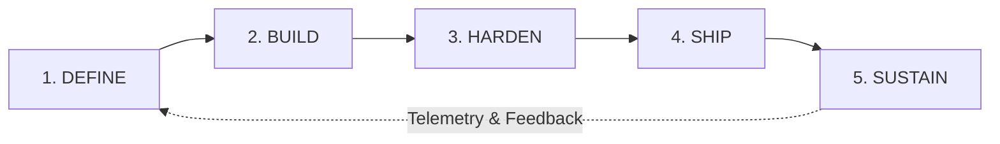

# Forgewright: Adaptive AI Engineering Orchestrator

Forgewright coordinates end-to-end software engineering through 5 autonomous lifecycle phases with continuous feedback loops.

## The 5 Lifecycle Stages

### Stage 1: DEFINE (Requirements & Schema Synthesis)
- Formulate unambiguous technical specifications and state machine diagrams.
- Lock database schemas and contract types (`@tinly/contracts`) before implementation.
- Establish empirical success metrics (latency targets, max memory limits, error budgets).

### Stage 2: BUILD (TDD & Component Assembly)
- Enforce strict Red-Green-Refactor development.
- Build modular, decoupled services and high-craft UI components (Impeccable & Vercel Best Practices).
- Isolate context per sub-task to maintain ultra-clean cognitive context.

### Stage 3: HARDEN (Security & Invariant Audit)
- Execute automated static analysis and dynamic fuzzing tests.
- Verify multi-tenant data boundaries (`tenantId`) and OWASP Top 10 vulnerabilities.
- Audit concurrency, async race conditions, and memory leaks.

### Stage 4: SHIP (Atomic Deployment & Verification)
- Zero-downtime PM2 / Docker service orchestration.
- Build bundle optimization, sourcemap generation, and static page pre-rendering.
- Execute live runtime smoke tests to verify HTTP/WebSocket health.

### Stage 5: SUSTAIN (Telemetry, Profiling & Self-Healing)
- Monitor process health, event loop latency, and database connection pools.
- Continuously cross-reference subagent findings against active system telemetry.
- Auto-trigger remediation loops if regressions or anomalies are detected.
