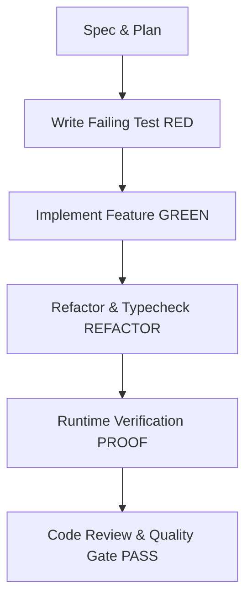

# Global Workflow: /feature-dev

Standard operational workflow for implementing new features reliably.

## Execution Sequence

1. **Step 1: Plan Ingestion**: Follow the approved implementation plan.
2. **Step 2: Red Test**: Add automated tests covering the target feature behavior and edge cases.
3. **Step 3: Implementation**: Implement minimum code needed to pass the tests while adhering to project style.
4. **Step 4: Refactoring**: Clean up code, remove duplication, and optimize queries/render paths.
5. **Step 5: Full Build & Verification**: Run build, verify live runtime behavior (UI, API, or worker).
6. **Step 6: Completion Report**: Provide executable summary and evidence of successful verification.
